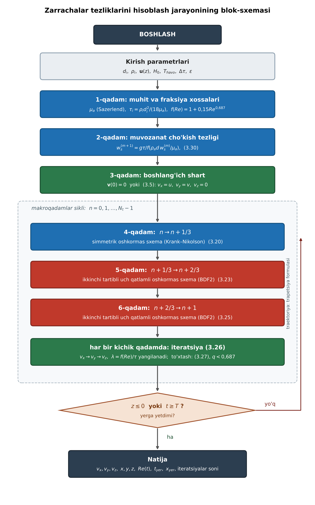
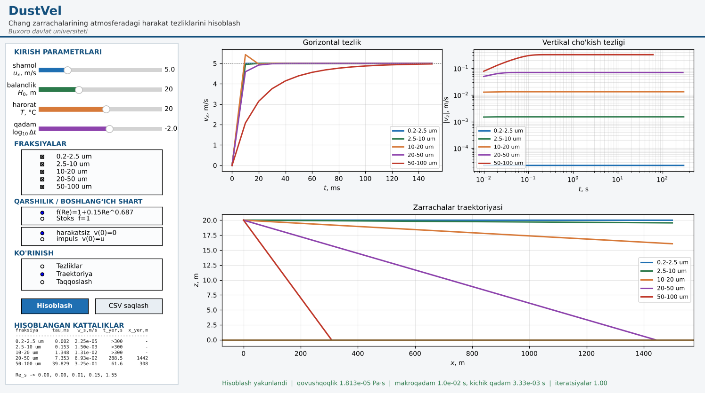

# DustVel

Chang zarrachalarining atmosferadagi harakat tezliklarini va traektoriyasini hisoblovchi dasturiy vosita.

[](https://www.python.org/)
[](LICENSE)

## Tavsif

DustVel shamol eroziyasi va texnologik jarayonlar natijasida atmosferaga ko'tarilgan chang zarrachalarining harakat tezliklarini hisoblaydi. Dastur zarracha tezligini shamol tezligiga tenglashtirmaydi. U zarrachaning inersion xossalarini va Reynolds soniga bog'liq aerodinamik qarshilikni hisobga olib, tezlikni alohida aniqlaydi.

Dastur Buxoro davlat universitetida bajarilgan dissertatsiya ishi doirasida yaratilgan. Hisoblash yadrosi dissertatsiyaning III bobi, § 3.1–3.2 ga mos keladi.

**2.0 versiyadagi o'zgarishlar**

- Stoks qonuni o'rniga Reynolds soniga bog'liq qarshilik ishlatiladi: `f(Re) = 1 + 0.15 Re^0.687`. Stoks rejimi taqqoslash uchun saqlangan (`--qarshilik stoks`).
- Har bir kichik qadamda chiziqsiz tenglamalar komponentalar bo'yicha iteratsiya bilan yechiladi.
- Muvozanat cho'kish tezligi chiziqsiz tenglamadan topiladi.
- Standart sifatida dissertatsiyadagi beshta fraksiya olingan.
- Logarifmik shamol profili qo'shilgan.

## Matematik asos

Zarracha harakati tenglamalari, (3.2)–(3.4) va (3.13):

```
dv_x/dt = lambda(v) (u - v_x)
dv_y/dt = lambda(v) (v - v_y)
dv_z/dt = lambda(v) (w - v_z) - g

lambda(v) = f(Re)/tau,   tau = rho_p d^2 / (18 mu_a)
Re = rho_a d |u - v| / mu_a,   f(Re) = 1 + 0.15 Re^0.687
```

Muvozanat cho'kish tezligi `w_s` quyidagi tenglamadan aniqlanadi, (3.6):

```
w_s f(rho_a d w_s / mu_a) = g tau
```

Bu tenglama oddiy iteratsiya bilan yechiladi: `w_s^(m+1) = g tau / f(Re(w_s^(m)))`, (3.30).

## Sonli algoritm

Tizim qattiq (stiff): `lambda*dtau` 10² … 10⁶ ga yetadi. Shu sababli oshkor sxemalar qo'llanilmaydi. Makroqadam `dtau` uchta teng qismga bo'linadi va ketma-ket uchta bosqich bajariladi:

| Bosqich | Sxema | Formula | Turg'unlik |
|---|---|---|---|
| `n → n+1/3` | simmetrik oshkormas sxema (Krank–Nikolson) | (3.20) | A-turg'un |
| `n+1/3 → n+2/3` | ikkinchi tartibli uch qatlamli oshkormas sxema (BDF2) | (3.23) | A- va L-turg'un |
| `n+2/3 → n+1` | ikkinchi tartibli uch qatlamli oshkormas sxema (BDF2) | (3.25) | A- va L-turg'un |

Masalan, birinchi bosqich formulasi:

```
v^{n+1/3} = [(6 - dtau*lam^n) v^n + dtau (lam^{n+1/3} u^{n+1/3} + lam^n u^n) - 2 dtau g delta_z] / (6 + dtau*lam^{n+1/3})
```

`lambda` yangi qatlamdagi tezlikka bog'liq, shuning uchun har bir bosqichda komponentalar bo'yicha iteratsiya bajariladi, (3.26):

```
v_x^(m+1) = Phi_x(lambda(v_x^(m), v_y^(m), v_z^(m)))
v_y^(m+1) = Phi_y(lambda(v_x^(m+1), v_y^(m), v_z^(m)))
v_z^(m+1) = Phi_z(lambda(v_x^(m+1), v_y^(m+1), v_z^(m)))
```

Iteratsiya `max|v^(m+1) - v^(m)| <= eps * max(1, |v|)`, `eps = 1e-10` shart bajarilganda to'xtatiladi, (3.27). Qisqartirish koeffitsiyenti `q < 0.687`, (3.29). Shu sababli iteratsiya istalgan qadamda yaqinlashadi va odatda 1–10 marta takrorlanadi.

Bosqichlar ketma-ketligi algoritmni o'z-o'zidan boshlanuvchi (self-starting) qiladi. Simmetrik sxema L-turg'un emas va qattiq rejimda tebranishlar hosil qilishi mumkin. Keyingi ikki uch qatlamli bosqich ularni so'ndiradi: makroqadamning kuchaytirish koeffitsiyenti `R → 0` (`Z → ∞`). Traektoriya har bir kichik qadamda trapetsiya formulasi bilan integrallanadi. Vaqt bo'yicha umumiy aniqlik `O(dtau²)`.



## O'rnatish

```bash
git clone https://github.com/ShafiyevT/DustVel.git
cd DustVel
pip install -r requirements.txt
```

## Foydalanish

### Buyruqlar qatori

```bash
python -m dustvel --ux 12 --uy 3.2 --h0 20 --taqqoslash
python -m dustvel --ux 8 --profil log --z0 1e-4 --hs 100
python -m dustvel --ux 12 --qarshilik stoks          # II bobdagi Stoks yaqinlashuvi
```

| Parametr | Tavsif | Standart |
|---|---|---|
| `--ux`, `--uy` | shamol tezligi tashkil etuvchilari, m/s | 5.0, 0.0 |
| `--profil` | `doimiy` yoki `log` (2.23) | doimiy |
| `--z0`, `--hs` | g'adir-budurlik va yer usti qatlami balandligi, m | 1e-4, 100 |
| `--h0` | chiqarish balandligi, m | 20.0 |
| `--vaqt` | hisoblash davri, s | 300 |
| `--dt` | makroqadam, s | 1e-2 |
| `-d`, `--rho-p` | bitta zarracha diametri (m) va zichligi (kg/m³) | — |
| `--qarshilik` | `re` yoki `stoks` | re |
| `--eps` | iteratsiya aniqligi | 1e-10 |
| `--boshlangich` | `harakatsiz` (v=0) yoki `impuls` (3.5) | harakatsiz |
| `--harorat` | havo harorati, K | 293.15 |
| `--fraksiya-fayl` | fraksiyalar JSON fayli | — |
| `--chiqish` | natijalarni CSV ga saqlash | — |
| `--taqqoslash` | soddalashtirilgan (v_p = u) model bilan taqqoslash | — |

### Grafik interfeys

```bash
python -m dustvel --gui
```

Interfeysda shamol tezligi, chiqarish balandligi, havo harorati va makroqadam surgichlar orqali o'zgartiriladi. Shuningdek, fraksiyalar, qarshilik qonuni va boshlang'ich shart tanlanadi. Uchta ko'rinish rejimi mavjud: tezliklar, traektoriya va soddalashtirilgan model bilan taqqoslash.



### Kutubxona sifatida

```python
from dustvel import Muhit, Hisoblagich, STANDART_FRAKSIYALAR

h = Hisoblagich(Muhit(ux=12.0, uy=3.2))          # qarshilik="re" standart
fr = STANDART_FRAKSIYALAR[4]                      # 50-100 um

print(f"tau = {h.tau(fr)*1e3:.2f} ms")
print(f"w_g (Stoks) = {h.stoks_tezligi(fr):.4f} m/s")
print(f"w_s (3.6)   = {h.chokish_tezligi(fr):.4f} m/s")

n = h.hisobla(fr, T=300.0, dt=1e-2, H0=20.0)
print(f"yerga yetish: t = {n.yer_t:.1f} s, x = {n.yer_x:.1f} m")
print(f"iteratsiyalar: o'rtacha {n.iter_ortacha:.2f}, maksimal {n.iter_maks}")
```

## Testlar

```bash
python tests/test_algoritm.py
```

Testlar quyidagilarni tekshiradi:

- relaksatsiya vaqti va muvozanat cho'kish tezliklari (beshta fraksiya);
- Stoks rejimi va undan farq;
- chiziqsiz va Stoks rejimlarida ikkinchi tartibli yaqinlashish;
- iteratsiyaning katta qadamda yaqinlashishi va L-turg'unlik;
- impulsli ko'tarilish sharti (3.5);
- logarifmik profil.

## Namunaviy natijalar

`(u, v) = (12; 3,2)` m/s, `H0 = 20` m, `dt = 1e-2` s, `T = 20 °C`:

| Fraksiya, µm | d, µm | ρ, kg/m³ | τ, ms | w_g (Stoks), m/s | w_s (3.6), m/s | farq, % | Re_s | t_yer, s | x_yer, m |
|---|---|---|---|---|---|---|---|---|---|
| 0,2–2,5 | 0,71 | 1500 | 0,002 | 2,25·10⁻⁵ | 2,25·10⁻⁵ | 0,00 | 0,00 | > 300 | — |
| 2,5–10 | 5,0 | 2000 | 0,153 | 1,50·10⁻³ | 1,50·10⁻³ | 0,08 | 0,00 | > 300 | — |
| 10–20 | 14,1 | 2200 | 1,35 | 1,32·10⁻² | 1,31·10⁻² | 0,74 | 0,01 | > 300 | — |
| 20–50 | 31,6 | 2400 | 7,35 | 7,21·10⁻² | 6,93·10⁻² | 3,88 | 0,15 | 288,5 | 3462 |
| 50–100 | 70,7 | 2600 | 39,8 | 0,391 | 0,325 | 16,86 | 1,55 | 61,6 | 739 |

Stoks qonuni 50–100 µm fraksiya uchun cho'kish tezligini taxminan 17 % oshirib baholaydi.

## Cheklovlar

- `f(Re)` formulasi `Re < 800` da o'rinli. Bundan katta qiymatda dastur ogohlantirish beradi.
- Submikron zarrachalar uchun Kanningem sirpanish tuzatmasi hisobga olinmagan.
- Turbulent diffuziya va konvektiv oqimlar qaralmaydi. Ular ko'chish-diffuziya tenglamasi orqali [DustFlow](https://github.com/ShafiyevT/DustFlow) majmuasida hisobga olinadi.

## Havolalar

Ravshanov N., Shafiyev T.R., Bobojonova M.A., Kobilova D.O. Issledovanie klyuchevyx faktorov, vliyayushchix na rasprostranenie pylevyx chastits v atmosfere // Problemy vychislitel'noy i prikladnoy matematiki. — 2026. — № 3(73). — S. 2–18.

## Litsenziya

MIT — [LICENSE](LICENSE) fayliga qarang.
